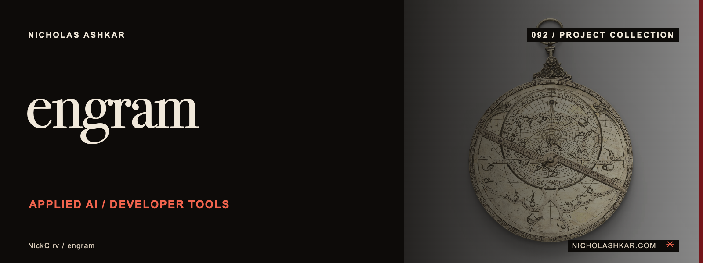

# Engram

A local structural code graph and context toolkit for AI coding agents. Engram indexes source entities, Git relationships and selected project memory, then exposes focused context through a CLI, agent hooks, MCP and an authenticated local dashboard.

Use it to find relevant code before reading full files, inspect relationships and carry recorded mistakes into a later session. Read the source returned by a query before making a behavioral claim: graph retrieval is an aid to investigation.

<a id="try-in-30-seconds-no-install"></a>
<a id="install-in-30-seconds"></a>
<a id="1-cli-recommended-starting-point--works-in-every-supported-ide"></a>
<a id="install"></a>
<a id="install--configuration"></a>

## Try it in 30 seconds, no install

`engramx` is published on npm, so `npx` runs it without installing anything globally and
without cloning this repository. Requires **Node >=20**.

```bash
export ENGRAM_NO_UPDATE_CHECK=1
npx --yes engramx@4.5.0 init . --no-hook
npx --yes engramx@4.5.0 query "auth" --budget 2000
npx --yes engramx@4.5.0 stats
```

Run that inside a git repository you can inspect. `init` writes the graph to `.engram/graph.db`
and prints what it extracted. The `--no-hook` flag matters: a default `init` also installs a
Sentinel hook into your agent configuration, and you should see the graph before you wire
anything into your editor.

Executed against a two-file demo repository on 2026-10-21 with `engramx@4.5.0`, `query "auth"`
printed:

```
Found 5 nodes (~99 tokens)

NODE authenticate() [function] src=src/auth.js L1
NODE auth.js [file] src=src/auth.js L1
NODE verifyToken() [function] src=src/auth.js L5
NODE server.js [file] src=src/server.js L1
NODE handle() [function] src=src/server.js L2
EDGE server.js --calls--> authenticate() [INFERRED 0.7]
EDGE server.js --imports--> auth.js
EDGE server.js --contains--> handle()
EDGE server.js --exports--> handle()
```

Those counts are from that demo repository, not a benchmark. Yours will differ.

**Matching is lexical over entity names and paths, not semantic.** On the same demo,
`query "auth"` and `query "authenticate"` both returned 5 nodes while `query "authentication"`
returned `No matching nodes found.` If a query comes back empty, try a shorter stem or a symbol
name that appears in the code rather than a concept word.

`stats` reports the graph size and is candid about when retrieval is not worth it. On a two-file
repository it printed `vs full: 1.1x LARGER, engram passes through`, because there is nothing to
summarise. The tool is built for codebases where reading the relevant files costs more than
reading the graph.

For a terminal recording of the mistake-capture flow, see
[the v4 cast on asciinema](https://asciinema.org/a/GjjvPXVyArnivAog).

### Install it properly

```bash
npm install -g engramx@4.5.0
engram --version
```

### Build from source instead

Use this if you want to read the code you are running, or work from a branch.

```bash
git clone https://github.com/NickCirv/engram.git
cd engram
npm install --ignore-scripts
npm run build
ENGRAM_NO_UPDATE_CHECK=1 node dist/cli.js --version
```

Executed on 2026-10-21 at commit `df445d3`, the current `main`: the build bundles 6 tree-sitter
grammars into `dist/grammars/` and `node dist/cli.js --version` reports `4.5.0`. Inspect the
package scripts before installing; `--ignore-scripts` is deliberate above, and the build step is
what produces `dist/`, which is not committed.


<a id="why-this-exists-may-2026"></a>

<a id="2-cursor--vs-code-extension-live-on-openvsx"></a>

<a id="3-continuedev-users"></a>

<a id="engramx--the-cached-context-spine-for-ai-coding-agents"></a>

<a id="one-command-to-everything"></a>

<a id="dashboard"></a>

<a id="design"></a>

<a id="benchmark"></a>

<a id="real-world-bench-new-in-v30-preferred"></a>

<a id="plugins-extend-what-engram-understands"></a>

<a id="ide-integrations"></a>

<a id="how-it-compares"></a>

<a id="cli-reference"></a>

<a id="http-api"></a>

<a id="mcp-server"></a>

<a id="ecp-spec"></a>

<a id="programmatic-api"></a>

## What is implemented

| Workflow | Source-backed entry points |
| --- | --- |
| Explore structure | `query`, `path`, `gods`, `callers`, `callees`, `impact`, `stats` |
| Maintain context | `init`, `watch`, `reindex`, `learn`, `mistakes` |
| Generate agent documents | `gen`, `gen-mdc`, `gen-aider`, `gen-windsurfrules`, `gen-ccs` |
| Inspect hook integration | `install-hook --dry-run`, `hook-preview`, `hook-stats`, `hook-disable`, `hook-enable` |
| Serve context | `server`, `ui`, `engram-serve` MCP executable |
| Review measurements | `measure`, `bench`, `cost`, package benchmark scripts |
| Maintain installation | `doctor`, `setup --dry-run`, `update --check`, database/cache/plugin commands |

These entry points are declared in the [pinned CLI](https://github.com/NickCirv/engram/blob/9fa2a4b74ca8e66560d74d1255c16c43157d32bd/src/cli.ts). Consult each command's help before a write operation. Generators, hook installers, cache/database commands and plugin installation can modify local state.

## Architecture

Source miners extract entities, references, Git co-change and selected mistake/session information. The graph store persists project-local SQLite using `sql.js`. Queries traverse the graph and render bounded context. The provider resolver combines built-in sources and optional plugins/MCP providers; integrations can add external processes and network access.

The [architecture and integration guide](docs/PORTFOLIO-GUIDE.md) maps these paths, documents HTTP authentication and gives a local MCP configuration. Existing design records, release notes, integration documents and the ECP draft remain linked in the [documentation inventory](docs/RESEARCH.md). They retain historical context and are not all certified against this revision.


<a id="im-not-a-developer--what-does-this-actually-do"></a>

<a id="proof-not-promises"></a>

<a id="what-engramx-is-not"></a>

<a id="privacy"></a>

## Privacy and operational boundaries

The core graph is local, but **the entire system is not guaranteed to be network-free**. The CLI has npm update checks, Context7 can call an external wrapper, and configured MCP/plugin providers can execute their own processes. `ENGRAM_NO_UPDATE_CHECK=1` disables the update-check path; it does not disable every optional integration. Review configured providers and the agent that receives graph output.

The HTTP server binds to `127.0.0.1`, validates Host/Origin and requires a bearer token or dashboard cookie for protected routes. It resolves a token from `ENGRAM_API_TOKEN` or a local token file. Keep that token private and retain the existing [security policy](https://github.com/NickCirv/engram/blob/9fa2a4b74ca8e66560d74d1255c16c43157d32bd/SECURITY.md).

## Limits and measurement

Structural context size, estimated token reductions, session replay and actual provider billing answer different questions. A smaller packet does not by itself demonstrate equal answer quality or a lower bill. Reproduce the included benchmarks on your own representative workload and track correctness alongside cost. This documentation review did not run a build, test suite, benchmark or agent session.


<a id="structured-task-bench-ci-regression"></a>

<a id="contributing"></a>

## Development

```bash
npm run build
npm run lint
npm test -- --run
```

The repository contains unit and integration test sources for graph storage, providers, hooks, HTTP security and other modules. Their presence is evidence of test coverage intent; results at this revision remain unverified here. See the preserved [contribution guide](https://github.com/NickCirv/engram/blob/9fa2a4b74ca8e66560d74d1255c16c43157d32bd/CONTRIBUTING.md) before changing behavior.


<a id="license"></a>

## License and author

[Apache-2.0 license](https://github.com/NickCirv/engram/blob/9fa2a4b74ca8e66560d74d1255c16c43157d32bd/LICENSE). The ECP specification carries its own attribution and licensing in its source document; this rewrite does not alter either.

[Nicholas Ashkar](https://nicholashkar.com) · Applied AI, systems and consulting.

## User guides

[User manual](docs/USER-MANUAL.md) covers setup, skills, troubleshooting and removal. [Sentinel](docs/SENTINEL.md) explains current hook behavior and guard modes. Tool authors can use the [integration guide](docs/INTEGRATION.md).
